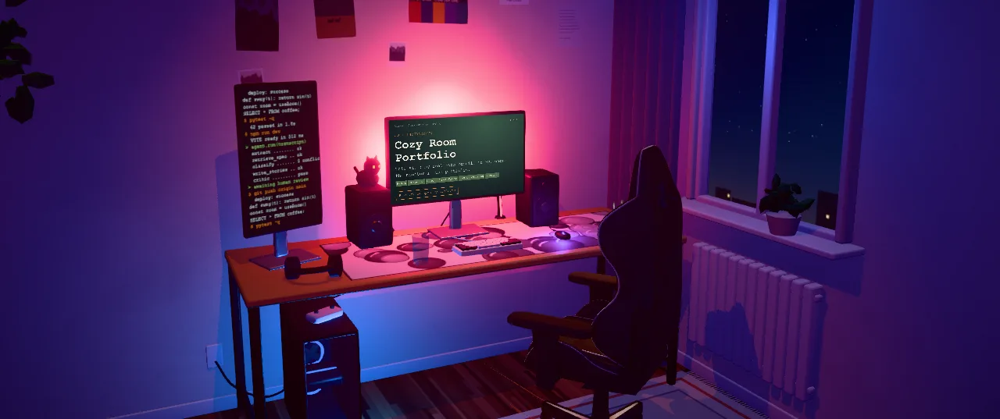

# Hi, I'm Arseni 👋

**Full-Stack AI Engineer** · C#/.NET · React/TypeScript · LLM agents & automation · Poznań, Poland

---

My portfolio is my real desk, rebuilt in 3D. Walk around the room, click the monitor and open my projects, CV and a little mini-game — everything is rendered live in your browser.

**What I do**

- Build **LLM agents and automation** that are reliable rather than just impressive: schema-validated outputs, deterministic rules with the final say, guardrails and human approval for risky actions.
- Ship **full-stack products**: C#/ASP.NET Core backends, React/TypeScript frontends, API integrations.
- Make **interactive and 3D experiences** with Three.js / React Three Fiber.

**Featured**

🏠 **[3D Portfolio](https://github.com/Gars0128/arseni-portfolio-3d)** — my desk in React Three Fiber: projects, CV and a mini-game live on the monitor. [Open it live ↗](https://arseni-portfolio-3d.vercel.app)

**Stack**

`Python` `FastAPI` `Temporal` `n8n` `OpenAI / Anthropic APIs` `C#` `ASP.NET Core` `EF Core` `React` `TypeScript` `Three.js` `Docker` `Playwright`
